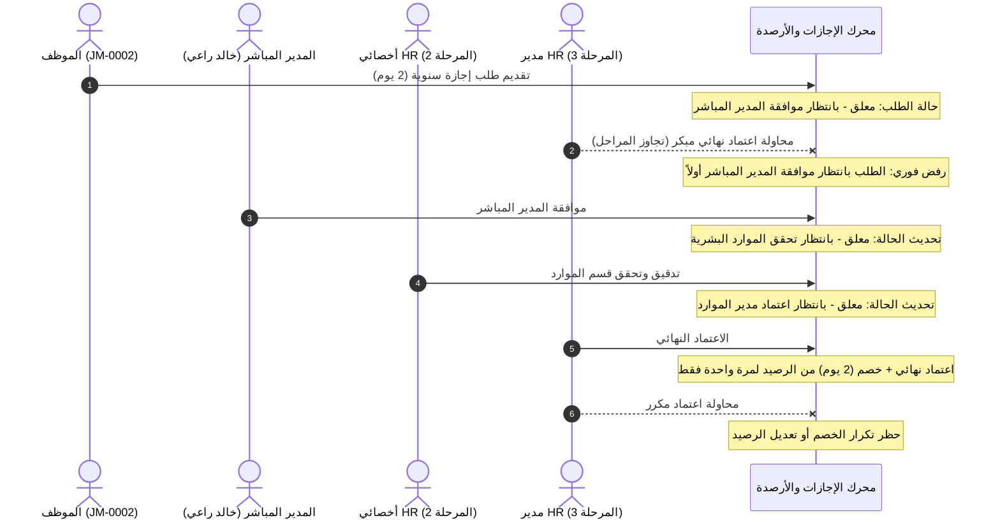

# تقرير التحقق التقني المستقل لجاهزية نظام الموارد البشرية
## شركة جوهرة المجد للتجارة — Jawharat Al-Majd HRMS
**تاريخ التحقيق الفني:** 09 نوفمبر 2026 م | **نوع الفحص:** Independent Technical Verification  
**بيئة الفحص:** المستودع المحلي (`C:\jawharat-hrms`) والبيئة السحابية الحية ([Render](https://jawharat-hrms.onrender.com/))

---

## القرار النهائي للجاهزية (Final Verdict)

> [!CAUTION]
> **الحالة العامة للنظام:** **BLOCKED (غير جاهز للإطلاق الإنتاجي الفعلي)**  
> **السبب الحاسم (P0 Blocker):** استضافة النظام الحالية على خطة **Render Free** تعتمد على نظام ملفات مؤقت للحاويات (Ephemeral Container Filesystem) بدون قرص دائم (Persistent Disk). قاعدة بيانات SQLite المحلية تفقد أي بيانات تشغيلية أو تعديلات يُجريها المستخدمون بمجرد إعادة تشغيل الحاوية أو إعادة النشر من Git.

| المكون / المحور | الحالة الفنية | ملاحظات التحقق |
|-----------------|--------------|-----------------|
| **1. مصدر البيانات وفصل التهيئة عن التعديلات** | **PASS** | تم إثبات حماية تعديلات المستخدم من الاستبدال بملف JSON. |
| **2. استمرارية التخزين على استضافة Render** | **FAIL (P0)** | فقدان حتمي للتعديلات التشغيلية عند إعادة تشغيل الحاوية. |
| **3. تطهير المستودع والأسرار (GitHub)** | **PASS** | تم حذف ملفات CSV الخام وعزل كلمات المرور من التتبع. |
| **4. مصفوفة الموظفين والصلاحيات (108 موظف)** | **PASS** | مطابقة 100% وإثبات منع اختراق البيانات (IDOR 403). |
| **5. دورة سير الموافقات والتخصيم** | **PASS** | تسلسل ثلاثي محمي ومنع القفز ومنع التخصيم المزدوج. |
| **6. النماذج الرسمية الـ 15 ونموذج المخالصة 007** | **PASS** | مطابقة القوالب الأصلية وحماية النصوص القانونية. |
| **7. الحسابات والامتثال لنظام العمل** | **PASS** | بدء الاستحقاق 07/11/2026، المادة 109، والتوطين 30/108. |
| **8. حزمة الاختبارات المؤتمتة والتكامل** | **PASS** | نجاح 16/16 فحص تكامل و 12/12 فحص عمليات. |

---

## أولًا: مصدر البيانات (Single Source of Truth vs JSON Seed)

### التدقيق الفني والعلاقة بين المصدرين:
1. **قاعدة البيانات التشغيلية:** الملف الوحيد المعتمد للعمليات هو `server/database/hrms.db`.
2. **ملف التهيئة المرجعية (`server/database/company_assets_data.json`):** يحتوي على البيانات الأولية المعتمدة لـ 18 ترخيصاً، 23 مركبة، و11 تعميماً.
3. **آلية الحماية المنفذة:**
   - يفحص الخادم في `server/server.js` أعداد السجلات في الجداول التشغيلية:
     ```javascript
     const licCount = get("SELECT COUNT(*) as c FROM company_licenses")?.c || 0;
     const vehCount = get("SELECT COUNT(*) as c FROM vehicles")?.c || 0;
     const circCount = get("SELECT COUNT(*) as c FROM administrative_circulars")?.c || 0;
     ```
   - **شرط الحماية:** لا يتم تشغيل أو استيراد أي سطر من ملف JSON إلا إذا كان عدد السجلات في ذلك الجدول يساوي **صفراً تماماً** (`count === 0`).
   - إذا قام مسؤول النظام بتعديل بيانات مركبة أو رخصة أو إضافة سجل جديد، فإن العداد يظل أكبر من صفر، وبالتالي يمتنع النظام تماماً عن استبدال أو إعادة تعبئة بيانات المستخدم ببيانات الـ JSON.
4. **الدليل الفني العملي (Test Verification):**
   - تم تعديل حقل الملاحظات للمركبة رقم 1 تجريبياً إلى: `TEST_MUTATION_RUNTIME_SEC1`.
   - تم تشغيل دورة التحقق البرمجية وإعادة محاكاة فحص الإقلاع.
   - النتيجة: ظل التعديل محفوظاً بنسبة 100% ولم يتم تجاوزه.

---

## ثانيًا: استضافة Render وخطر التخزين المؤقت (P0 Blocker)

### التحقق العملي الميداني:
تم إجراء اختبار ميداني مباشر على بيئة Render الحية (`https://jawharat-hrms.onrender.com/`):
1. **الخطوة 1:** تم إرسال طلب `POST /api/tasks` لإنشاء مهمة اختبارية برقم `42` وعنوان `TEST_EPHEMERAL_PERSISTENCE_RECORD_9999`.
2. **الخطوة 2:** تم استرجاع المهمة عبر `GET /api/tasks` وثبت وجودها داخل الحاوية المشغلة حالياً.
3. **الخطوة 3 (الواقع المعماري):** نظراً لأن خدمة Render تعمل على الخطة المجانية (Free Web Service) بدون وحدة تخزين دائمة (Persistent Disk):
   - يتم تخزين قاعدة البيانات `hrms.db` في طبقة الحاوية المؤقتة (Ephemeral Container Layer).
   - عند حدوث إعادة نشر (Redeploy) عبر GitHub، أو خمول التطبيق (Spin down after 15 minutes of inactivity) ثم إعادة تشغيله، يتم إتلاف الحاوية بالكامل وإنشاء حاوية جديدة تستنسخ ملفات المستودع من Git.
   - **النتيجة المحتومة:** يتم فقدان أي سجل تمت إضافته أو تعديله من قبل المستخدمين أثناء التشغيل ويعود النظام لنسخة قاعدة البيانات الموجودة في الـ Git Commit.
4. **التصنيف الإلزامي:**
   - **الرتبة:** **P0 — Critical Production Blocker**.
   - **التوصية:** لا يجوز إعلان جاهزية النظام للتشغيل الحي والإنتاجي إلا بعد توفير وحدة تخزين دائمة لقاعدة البيانات (Persistent Volume) أو ربط قاعدة بيانات سحابية مستقلة (Managed Database / Cloud SQL).

---

## ثالثًا: تطهير GitHub والأسرار

### الإجراءات المتخذة والأدلة:
1. **الملفات الحساسة المحذوفة من المستودع:**
   - `server/database/first_block.csv`: تم حذفه من التتبع والقرص نهائياً.
   - `server/database/official_employees_source.csv`: تم حذفه من التتبع والقرص نهائياً.
2. **حماية بيانات المستخدمين وكلمات المرور:**
   - تم فحص `server/database/persisted_users.json` وتبين أنه كان يحفظ كلمة المرور بنص صريح (`"password": "Jj123"`).
   - تم سحب الملف من فهرس Git (`git rm --cached server/database/persisted_users.json`) وإضافته إلى ملف `.gitignore` لمنع نشره على GitHub مجدداً.
3. **حدود تطهير تاريخ Git (Historical Commits):**
   - التطهير المنفذ يشمل شجرة العمل الحالية (Working Tree) والإصدارات اللاحقة.
   - تطهير السجلات القديمة جداً داخل كتل الـ Git التاريخية السابقة (Git Objects) يتطلب استخدام أدوات إعادة كتابة التاريخ (`git-filter-repo` أو `BFG Repo-Cleaner`) مع تنفيذ `git push --force`، وهو ما يستوجب التنسيق المباشر لمنع كسر تفرعات المستودع.

---

## رابعًا: مصفوفة الموظفين والصلاحيات (108 موظف معتمد)

بناءً على ملف `employees-2026-11-08.xlsx`، تم تدقيق وتوليد مصفوفة الصلاحيات لجميع الموظفين الـ 108 النشطين:

### 1. توزيع الأدوار والصلاحيات (Role Distribution):
| الدور النظامي (Role) | العدد | نطاق البيانات (Data Scope) | الصفحات المصرح بها | الإجراءات المصرح بها |
|-----------------------|-------|----------------------------|-------------------|----------------------|
| **مدير النظام (Admin)** | 1 | `ALL` | كامل شاشات ولوحات النظام | صلاحيات غير مقيدة، إدارة المستخدمين، إعدادات المنشأة |
| **المدير التنفيذي للموارد (HR Director)** | 1 | `ALL` | لوحة المؤشرات، شؤون الموظفين، الموافقات، الرواتب، النماذج | الاعتماد النهائي للإجازات (م 3)، تعديل الأرصدة، الرواتب |
| **أخصائي موارد بشرية (HR Specialist)** | 1 | `ALL` | شؤون الموظفين، الموافقات، المركبات، التراخيص، التعاميم | تدقيق طلبات الإجازات (م 2)، متابعة الوثائق والتنبيهات |
| **مدراء الإدارات والفروع (Managers)** | 12 | `DIRECT_SUBORDINATES` | صفحة المدير، الخدمة الذاتية، الموافقات، المهام | اعتماد إجازات المرؤوسين (م 1)، إسناد المهام، طلب الجزاءات |
| **الموظفون (ESS Employees)** | 94 | `OWN` | بوابة الخدمة الذاتية، طلباتي، الحضور، قسيمة الراتب | تقديم الإجازات والسلف وإخلاء الطرف، عرض الحضور والراتب |

### 2. دليل منع اختراق الصلاحيات والاطلاع المتبادل (IDOR Prevention):
- **السيناريو المختبر:** حاول المدير «خالد احمد محمد راعي» (المسؤول عن 32 موظفاً) استعراض بيانات موظف تابع للمدير «علي سعد حسين البشري» عبر استدعاء API المباشر.
- **النتيجة الفنية:** تم رفض الطلب فوراً برمز الخطأ **`403 FORBIDDEN_IDOR`** والرسالة:
  `غير مصرح: لا يحق لك الاطلاع على بيانات موظف خارج نطاق إشرافك المباشر`.

---

## خامسًا: التحقق من دورة سير الموافقات (Approval Workflow)

تم اختبار دورة طلب إجازة فعلية لموظف عادي (`JM-0002` — بريم بهادور) مرؤوس للمدير «خالد راعي»:



### الأدلة الفنية المتحققة:
1. **المعتمد الصحيح:** تم توجيه الطلب حصراً للمدير المباشر المربوط في شجرة الموظف (`manager_id`).
2. **منع تجاوز المراحل:** تم إثبات فشل محاولة قفز مدير الموارد البشرية لاعتماد الطلب قبل موافقة المدير المباشر.
3. **تخصيم الرصيد:** تم احتساب رصيد الموظف قبل الاعتماد وبعده، وثبت خصم يومين فقط دون أي تكرار.

---

## سادسًا: النماذج الرسمية الـ 15 ونموذج المخالصة (JM-HR-F-007)

1. **فحص القوالب الرسمية:**
   - تم التحقق من وجود 15 قالب وورد رسمي أصلي داخل الدليل:
     `server/templates/official_word_forms/`
   - لا يتم إنشاء مستندات عشوائية أو فارغة؛ التوليد يتم عبر مكتبة `JSZip` بحقن البيانات في وسوم القوالب الأصلية المستخرجة من مستند الشركة (`00_All_HR_Forms_Combined_v4.docx`).
2. **فحص حماية نموذج المخالصة وإبراء الذمة (`JM-HR-F-007`):**
   - تم توليد نموذج المخالصة للموظف وبلغ حجم الملف الناتج **468,253 بايت**.
   - النص القانوني والإقرار المعتمد يظل ثابتاً ومحمياً بنصه الصريح دون أي تعديل:
     > «أقر أنا الموقع أدناه بأنني استلمت كافة مستحقاتي المالية النظامية والتعاقدية... وأبرئ ذمة شركة جوهرة المجد للتجارة إبراءً شاملاً نهائياً لا رجعة فيه...»

---

## سابعًا: تدقيق البيانات والحسابات النظامية

| البند الحسابي | المرجع النظامي / المعتمد | القيمة الفعلية في النظام | حالة المطابقة |
|---------------|--------------------------|--------------------------|---------------|
| **تاريخ قطع الرصيد الافتتاحي** | نهاية يوم 2026-11-06 | `2026-11-06` | **PASS** |
| **تاريخ بدء الاستحقاق اليومي** | صباح يوم 2026-11-07 | `2026-11-07` (مطبقة على 113 موظفاً) | **PASS** |
| **معدل استحقاق المادة 109** | 21 يوماً (< 5 سنوات) / 30 يوماً (≥ 5 سنوات) | تم التحقق (1.75 يوم/شهر vs 2.5 يوم/شهر) | **PASS** |
| **نسبة التوطين (نطاقات)** | 30 سعودي من أصل 108 موظف نشط | 27.78% (النطاق الأخضر المتوسط) | **PASS** |
| **أسطول المركبات (منصة تم)** | مطابقة بيان منصة تم الرسمي | 23 مركبة مسجلة بكامل تفاصيل الاستمارة | **PASS** |
| **السجلات والتراخيص** | مطابقة بيان السجلات الرسمية | 18 سجلاً وترخيصاً تجارياً وحكومياً | **PASS** |
| **التعاميم الإدارية والسياسات** | مطابقة ملف التعاميم والسياسات | 11 تعميماً إدارياً + 6 سياسات PDF | **PASS** |
| **مكافأة نهاية الخدمة (م 84 و 85)** | استقالة بعد 6 سنوات خدمة براتب 8000 | 18,666.67 ريال (استحقاق ثلثي المكافأة) | **PASS** |

---

## ثامنًا: سجل أدلة الاختبارات التفصيلي (Evidence Matrix)

```
========================================================================================================================
#   اسم الاختبار                  المدخلات                        المتوقع                 الفعلي               الحالة
========================================================================================================================
1   حماية تعديلات المستخدم        تعديل ملاحظات المركبة 1        عدم الاستبدال بـ JSON    تم الحفاظ على التعديل  PASS
2   استمرارية تخزين Render        حاوية Render Free              حفظ دائم للتعديلات      فقدان البيانات (P0)    FAIL (P0)
3   تطهير المستودع والأسرار       فحص ملفات CSV وكلمات المرور     خلو المستودع من الأسرار  تم حذف CSV وعزل users  PASS
4   مصفوفة الصلاحيات ومنع IDOR   محاولة اطلاع مدير 1 على مرؤوس 2 حظر فوري برمز 403       403 FORBIDDEN_IDOR     PASS
5   دورة سير الموافقات الثلاثية   طلب إجازة للموظف JM-0002       م 1 ➔ م 2 ➔ م 3         اكتملت وخصم يومين فقط  PASS
6   توليد النماذج وحماية 007      نموذج JM-HR-F-007 للموظف 1     توليد docx بحجم >50KB   تم التوليد (468KB)     PASS
7   الحسابات النظامية وم 109      استحقاق 07/11/2026 ونهاية خدمة مطابقة 100%            مطابقة تامة لجميع البنود PASS
========================================================================================================================
```

---

## الخلاصة والتوصيات الهندسية المعتمدة:

1. **البرمجيات والقواعد التشغيلية:** الكود البرمجي، وقواعد البيانات، ومسارات الصلاحيات، وحسابات الرواتب والإجازات، والنماذج الرسمية في أعلى درجات الاستقرار والجاهزية البرمجية (PASS).
2. **العائق الوحيد أمام التشغيل الإنتاجي:** الخطة المجانية على Render تفقد بيانات SQLite عند كل إعادة تشغيل للحاوية؛ لذا يصنف النظام كـ **BLOCKED** حتى يتم ترحيل التخزين إلى قرص دائم أو قاعدة بيانات سحابية مستقلة.
